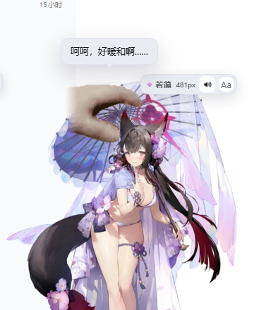

# 若藻 · DSH 桌宠（dsh-wakamo-pet）

一个给 **DeepSeek Harness（DSH）Web GUI** 用的非官方同人桌宠插件：把《蔚蓝档案》的**狐坂若藻（泳装）**完整立绘放进 DSH 界面，能拖、能抓起来掉下去、能摸头、能拉弹簧、会眨眼、会按原作性格说话，并带日配语音。

> **非官方同人作品**，与 NEXON Games、NEXON、Yostar、《蔚蓝档案 / Blue Archive》均无隶属或授权关系。角色立绘、语音等素材版权不属于本项目；代码使用 MIT，但**素材不包含在 MIT 授权内**，仅供个人学习/本地使用，请勿商用或再分发素材。详见 [ASSET_NOTICE.md](ASSET_NOTICE.md)。



## 最新版本：v1.1.0（2026-10-20）

- **新增右键查询**：右击若藻，显示北京时间、DeepSeek 当前高峰/空闲时段以及下次切换时间。本地计算，不消耗 API Token。
- **弹簧与重力更顺畅**：合并下拉动画更新，修正帧率对阻尼的影响，改善短暂掉帧时的运动连续性。
- **修复切表情闪烁**：预先解码表情图层，取消整张立绘的淡入淡出，避免人物短暂变透明。
- **验证**：10 项自动测试通过，另通过 Edge 表情切换、右键查询、弹簧与重力交互测试。

时段查询采用 2026-10-19 核对的官方规则，内置 2026 年节假日表，不会自动联网更新；超出支持年份会提示无法准确判断。更新插件后，请完全重启 DSH Web，再强制刷新页面。

完整版本记录见 [CHANGELOG.md](CHANGELOG.md)。

---

## 这是什么

- 一个 **DSH Web 插件**，不是独立 App，也不是 Live2D/Spine 工程。
- 注册在 DSH 的 `shell.overlay` 插槽，悬浮在所有栏目之上，不改变页面布局。
- 角色是《蔚蓝档案》**狐坂若藻（泳装）**，使用官方立绘差分、官方台词与日配语音，外加经典 petpet 摸头手。
- 所有图片/语音/手部帧都内联进 `client.js`，不需要额外静态服务或后端。

### 它不是什么

- 不是模型/Agent 功能插件，不影响对话、工具或上下文。
- 不是 3D 模型，也没有骨骼绑定；拉伸、压扁、掉落都是 CSS/Web Animations 与 requestAnimationFrame 做的视觉效果。
- 不会联网拉取素材；装好后离线也能用（语音是内嵌的）。

---

## 功能

| 功能 | 说明 |
| --- | --- |
| 完整立绘 | 狐坂若藻（泳装）全身立绘，含伞、裙摆、尾巴、光环与花饰 |
| 抓取物理 | 按住身体拖动可把她抓起来；松手后受重力下落，带横向惯性、左右边缘反弹、落地压扁与轻微“咚”声 |
| 弹簧回弹 | 按住头部往下拉会把身体压扁，松手后用最大力**弹到窗口顶部**，再落回原地并小回弹 |
| petpet 摸头 | 按住头部约 0.4 秒进入摸头：经典 petpet 像素手 5 帧循环，配“呵呵，好暖和啊……”与语音；长按 7 秒触发第二句 |
| 眨眼 | 从眨眼帧裁出的**眼部贴片**，每 3–7 秒闭合 130ms；只换眼睛，不整张图切换 |
| 随机待机表情 | 每 2.5–4 分钟随机说一句原作台词，配柔和表情与气泡 |
| 表情差分 | 微笑、害羞、开心、鼓脸、惊讶、委屈等，按互动切换 |
| 日配语音 | 12 段官方日配原声（登录、摸头、戳一戳、生气、待机等），Web Audio 播放 |
| 静音 | HUD 喇叭按钮一键静音，所有语音/音效都遵守 |
| 自由缩放 | 左上角手柄拖动 220–760px 连续缩放；`Aa` 在 320/460/600/760 间循环 |
| 位置记忆 | 拖动/掉落后的位置、大小、静音状态存在浏览器 localStorage，刷新后保留 |
| 主题适配 | 气泡、HUD 使用 DSH 主题 token；立绘保留自身颜色 |

### 语音/台词示例

| 场景 | 台词 |
| --- | --- |
| 登录 | 老师，欢迎回来。若藻我正怀着一日三秋般的思念等待着您♥ |
| 摸头 | 呵呵，好暖和啊…… |
| 长按摸头 | 老师……老师……！亲·爱·的·老·师·♥ |
| 戳一戳 | 您可以吩咐我做任何事。对，就是字面意思，“任何事”♥ |
| 连戳生气 | 差不多该结束了吧。 |
| 缩放 | 哼哼哼……若藻的这副身姿，请勿错过任何一瞬。阁.下♡ |

语音为日配（斋藤千和），文字为官方简中翻译。中配（子音）的台词也在素材站，可按同样方式替换。

---

## 操作方式

| 操作 | 效果 |
| --- | --- |
| 按住身体拖动 | 抓起她；松手后重力掉落、弹跳、停在窗口底部 |
| 按住头部不动 0.4s | 摸头（petpet 手 + 台词 + 语音） |
| 按住头部往下拉 | 弹簧压扁；松手弹到窗口顶部再落回 |
| 短按 | 随机表情 + 原作台词 |
| 快速连点 4 下 | 鼓脸生气：“差不多该结束了吧。” |
| 拖动左上角小方块 | 连续缩放 |
| 点 HUD 的 `Aa` | 循环预设大小 |
| 点 HUD 的喇叭 | 静音/恢复语音 |
| 拖动位置 / 掉落后 | 自动记忆 |

> 想固定位置时，把她拖到目标位置后轻轻放下即可；物理会让她落到窗口底部，这是设计行为。

---

## 安装

### 从 GitHub 安装（发布后）

```powershell
dsh plugin --profile web add github:<owner>/dsh-wakamo-pet
```

### 从本地目录安装

```powershell
dsh plugin --profile web add "C:\path\to\dsh-wakamo-pet"
```

或者在 DSH 的「插件」页里安装本地 bundle 目录。

安装后**完全重启 DSH Web**，再刷新页面（Ctrl/Cmd + F5）。如果只刷新页面没有生效，请退出 DSH 再启动。

### 环境要求

- 已安装并启用 DSH Web GUI（Chromium/Edge 内核）。
- 本项目在 Windows + DSH Desktop 环境测试；其他平台/版本未验证。
- 语音使用 Web Audio；首次加载的打招呼可能因浏览器自动播放策略静音，点她一下后恢复。

---

## 构建

### 换角色 / 换素材

给另一个 AI 的完整替换指南见 [docs/AI_ASSET_SWAP.md](docs/AI_ASSET_SWAP.md)：包含同系列 `CHxxxx_spr` 的选帧、导出、眼贴坐标、语音、元数据和验证清单，熟手 5–10 分钟能换一个角色。


```powershell
python src/build_assets.py
```

脚本会把 `assets/` 里的立绘帧、语音、petpet 手帧和眼部贴片转成 data URL，内联进 `client.js`。依赖 Python 3 与 Pillow。

- `src/client.template.js`：客户端逻辑（React、CSS、动画、物理）。
- `index.js`：Host 半身，当前为空（只提供 bundle 行）。
- `cordis.patch.yml`：DSH bundle patch。
- `assets/`：立绘帧、语音 `.ogg`、petpet 手帧、眼部贴片。
- `locale/`：插件管理页显示的中英文标题与描述。

### 文件结构

```
dsh-wakamo-pet/
├─ package.json
├─ cordis.patch.yml
├─ index.js                 # Host 半身（空实现）
├─ client.js                # 构建产物，内联所有素材
├─ icon.png                 # 插件图标
├─ locale/{en,zh}.json      # 插件元数据
├─ assets/
│  ├─ idle.webp 等立绘帧
│  ├─ voices/*.ogg
│  ├─ hand/*.png            # petpet 手 5 帧
│  └─ eye-blink.png         # 眼部眨眼贴片
├─ src/
│  ├─ client.template.js
│  └─ build_assets.py
├─ ASSET_NOTICE.md
└─ LICENSE
```

---

## 实现说明

- **渲染**：Client 半身通过 `ctx.slots.register({ name: 'shell.overlay', ... })` 注册；React 来自 DSH 的模块表，不需要额外打包 React。
- **表情**：所有差分帧预先渲染为叠放的 ``，只切换 `data-active` 透明度；身体呼吸动画放在外层容器，避免换脸时身体错位或空白帧。
- **眨眼**：单独的眼部 PNG 贴片，按立绘百分比定位，130ms 显隐；不再切换整张立绘。
- **物理**：拖动时记录速度，松手后用 `requestAnimationFrame` 积分重力/速度，直接改外层 `transform`；落地反弹系数 0.42，左右边缘反弹，静止后写回 `left/top` 并持久化。
- **弹簧**：松手后对根元素做 Web Animations 弹道（最高到窗口顶部），同时对立绘容器做拉伸/压扁。
- **语音**：`AudioContext.decodeAudioData` 解码内嵌 OGG，AudioBufferSource 播放；不依赖网络或 `<audio>` 标签。
- **状态**：`localStorage` 键为 `tachibana-pet:*`（size/position/sound/greeted/introduced）。

---

## 素材与版权

- 角色立绘、表情差分、语音：《蔚蓝档案》官方素材，取自 [kivo.wiki 狐坂若藻（泳装）](https://kivo.wiki/data/character/41)，版权归 NEXON Games / Yostar 所有。
- petpet 手部 sprite：经典 petpet 摸头梗，取自 [benisland.neocities.org/petpet](https://benisland.neocities.org/petpet/)。
- 本项目代码：MIT（见 [LICENSE](LICENSE)）。
- **素材不在 MIT 授权范围内**，不随代码授权；请勿将素材用于商业用途或再次分发。公开仓库仅用于同人交流/学习，若版权方要求会删除。

详见 [ASSET_NOTICE.md](ASSET_NOTICE.md)。

---

## 已知限制

- 素材版权风险：公开分发包含官方立绘/语音的仓库可能收到 DMCA；建议私有或只分发代码。
- 首次加载的问候语音可能被浏览器自动播放策略拦截，点击后恢复。
- 位置/大小按浏览器 origin 存储；清除站点数据会复位。
- 物理/弹簧是装饰性效果，不与 DSH 的 UI 做碰撞检测。
- 内联素材使 `client.js` 约 1.9 MB；后续可改为按需加载。
- 只在 Windows + DSH Desktop 验证；不同 DSH 版本的 slot/loader 行为可能变化。

---

## English

A fan-made **Wakamo (Blue Archive, swimsuit) desktop pet** plugin for the DeepSeek Harness Web GUI. It renders in the `shell.overlay` slot with the full-body official sprite, expression differentials, Japanese voice clips, and the classic petpet hand.

- Drag the body to pick her up; release to drop with gravity, horizontal momentum and floor/edge bounces.
- Pull her head down and release to launch her to the top of the window like a spring.
- Hold her head for 0.4 s to trigger petpet headpats (5-frame pixel hand + voice); hold 7 s for a second line.
- Blinks use an eye-only patch; random idle lines/expressions every few minutes.
- Resize with the top-left grip or the `Aa` preset button; mute with the speaker button.

**Fan work, not affiliated with NEXON/Yostar/Blue Archive.** Character artwork and voice assets are copyrighted and excluded from the MIT license; personal/local use only. See `ASSET_NOTICE.md`.

---

## License

Code: MIT. Assets: all rights reserved by their original owners; not covered by the MIT license.
